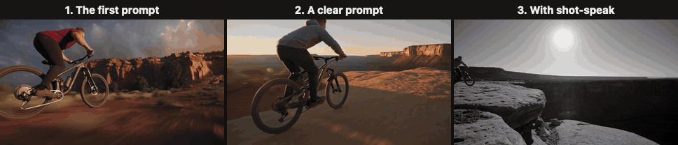
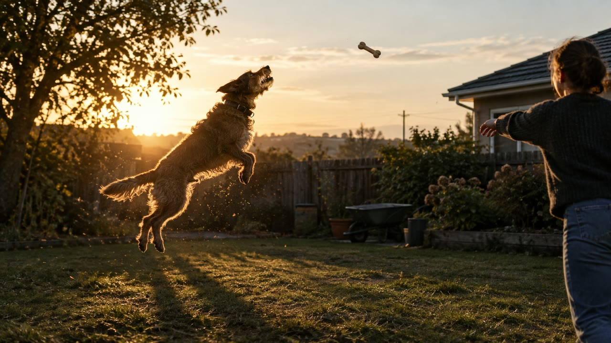

# shot-speak

> **"I want my dog to do a bullet time thingy when I throw him a bone. Dramatically."**
>
> You know exactly what you mean. Your video generator does not. It hears "dog", "dramatic" and "bullet time",
> shrugs, and hands you a golden retriever floating in a soft glow while the camera circles him like a
> bored shark. The dog looks straight at you. He knows it is bad, too.
>
> The shot in your head has a name, a lens, a place for the camera and a reason for the light. You should not
> need film school to get it. You need a translator who went, and who does not make you fill in a form.

**Say the shot in your own words. Get it back in film language.**



**[Try the interactive walkthrough](docs/walkthrough/index.html)**: step through this session, click the 4
options, try a mix, and compare a bad prompt with a good one. Open the file from a clone of this repository.

`shot-speak` is an agent skill for Claude Code and Codex. It turns words like "that swishy movement",
"the bullet time thingy" or "make it look dramatic" into 3 to 4 real, different shot options.
For each option you get:

- a **mock still** that shows the framing, the lens feel, the light and the colour;
- the **6 decisions** a film crew makes: camera movement, camera placement, lens, lighting, colour grade, speed;
- a **plain explanation**: what the viewer feels, the pro term to learn, when to choose it;
- the **risks with AI video generators**, and the words that reduce them;
- a **1-line prompt** that works in any video generator. No model names, no brand names.

Then you pick 1, mix parts of 2, or ask for others. The skill returns a final shot spec and a ready prompt block.

It also does these things:

- **"Like that film."** Name a film, a director or a genre. The skill turns the name into decisions and
  keeps the name out of every prompt.
- **Finds an unclear look with you.** For "epic but sad", it shows reference links and small rounds of mock
  stills until you say "that one".
- **Blocking previs.** With a local Blender, it builds a grey-box scene for each option: the real lens, the
  camera height, the camera path. It is free.
- **Sequences.** It writes a multi-shot prompt with exact cut times for a fight, a hit or a small scene.
- **De-slop mode.** Paste a video prompt. The skill shows which parts give the generic "AI look" and rewrites them.
  A technique that you chose (fog in the story, a look into the lens for an interview) stays.

The skill is a helper, not a procedure. If you know what you want, say "just give me the prompt".
It has 4 fixed rules only: a clear yes before money is spent, no names in a generator prompt, no personal
data to a provider, and no printed keys.

## Why

AI video generators answer a vague prompt with their defaults: a centred person who looks into the lens,
a chest-height medium shot, a soft golden glow, haze, a wet floor, a slow floating camera, slow motion everywhere.
People call the result "AI slop". The fix is not a better adjective. The fix is a decision about where the
camera stands, which lens it has, where the light comes from and how fast things move.

This skill holds those decisions as a catalogue: 25 techniques, 11 lighting setups, 9 grades, 6 speeds,
34 look recipes and 22 AI-slop tells with their fixes. The lessons come from real AI film production work,
where each one cost credits to learn.

## Example: the same idea, 3 prompts, 3 real videos

1 idea went to a video model 3 times, as 3 prompts. "What you get" is an observation, not a measurement.
The tables and prompts come from the real files in [`examples/bike-cliff/`](examples/bike-cliff/).

<!-- BEGIN GENERATED: examples -->


Full-quality MP4s with sound: [prompt 1](docs/video/bike-cliff/1_noob.mp4) · [prompt 2](docs/video/bike-cliff/2_plain.mp4) · [prompt 3](docs/video/bike-cliff/3_skill.mp4)

> 10 seconds of a cool action scene: a guy rides a bike over a cliff, ditches the bike mid-air and does a superhero landing

|  | 1. The first prompt | 2. A clear prompt, no film language | 3. With shot-speak |
|---|---|---|---|
| **What you get** | A man in a dark red shirt and dark trousers, not the grey hoodie of the idea. He hangs in the air for about 4 seconds, the camera looks up at him, and he lands on a fist and stares into the lens. | The grey hoodie and jeans, a fast ride off the edge, and a landing on a knee and a fist. Dust fills the frame and the light is warm and even. He ends upright and looks off to the side. | 5 shots in the warm colour of red rock, with 1 hard sun. The close-up is on his hands as the bike leaves them. The landing is a low shot on the canyon floor with a big burst of dust. Then a medium shot shows his face as he stands, with the bike on the ground behind him. |

Same model, same face reference, 1 take each. Only the prompt changed. The 2 commands and the plan are in [`examples/bike-cliff/`](examples/bike-cliff/).

<details>
<summary>The 3 prompts and the shot-speak decisions</summary>

**1. The first prompt**

```text
insane epic cinematic 4k shot of a guy riding a bike off a cliff then he jumps off the bike in mid air and does a superhero landing, slow motion, camera orbiting around him, dramatic lighting, hyper realistic, 10 seconds
```

**2. A clear prompt with no film language**

```text
A man wears a grey hoodie and jeans and rides a mountain bike fast toward a cliff edge in a rocky desert canyon in the late afternoon. He rides off the edge and flies out over the canyon. In the air he lets go of the bike and pushes it away, and the bike falls away below him. He drops about 4 metres onto a flat sandy ledge and lands on one knee and one fist, and dust bursts out around him. Then he stands up slowly and looks out over the canyon.
```

**3. shot-speak: option A (Low-angle wide shot), build to a peak**

In plain words: 3 shots that get closer and shorter, then the peak, then a still ending. The hero shot is option A: The camera sits on the floor with a wide lens and looks along the ground. The subject towers.

| Decision | Value |
|---|---|
| Camera movement | locked: the camera does not move, the action comes to it |
| Camera placement | on the floor, 3 m away, the lens level and looking along the ground into the light |
| Lens | 18 mm |
| Light | One hard low sun, camera facing into the light |
| Colour grade | Warm natural |
| Speed | Slow motion (one beat) |

The 5 shots, with hard cuts at 2.5, 4.5, 5.5, 8.5 s:

| # | Time | Shot | What happens |
|---|---|---|---|
| 1 | 0 to 2.5 s | wide shot, 24 mm | he pedals hard from screen left toward the cliff edge |
| 2 | 2.5 to 4.5 s | medium shot, 50 mm | the front wheel leaves the edge and he flies out over the drop |
| 3 | 4.5 to 5.5 s | close detail, 85 mm | in the air he lets go and pushes the bike away from his body |
| 4 | 5.5 to 8.5 s | low-angle wide shot, 18 mm (hero) | he drops from the top of the wall and lands under full control in a clean superhero landing: feet first, knees bend deep to absorb the impact, then he drops to one knee with one fist planted, back straight, head up; dust bursts out around him |
| 5 | 8.5 to 10 s | medium shot, 35 mm | he rises slowly and steadily from the landing pose into a confident stand and looks up at the cliff edge he jumped from; his face is clearly visible and lit by warm light bouncing up from the sand, with the sun rim on his hair; the bike lies on its side behind him |

The prompt as sent, without the `@Image1` lines of the face reference:

```text
SEQUENCE: 10 s, 16:9. 5 shots, 4 hard cuts at exactly 2.5, 4.5, 5.5 and 8.5 s. One action and one camera move in each shot.
SUBJECT: exactly 1 person: a man in a grey hoodie, dark jeans and trainers, on a mountain bike, in a rocky desert canyon in the late afternoon. He never looks into the lens.
STAGE: 1 cliff edge on top of a 4 m high rock wall, and the flat sandy canyon floor at the foot of the wall. He lands on the canyon floor: after the landing, the ground around him is flat and nothing drops away behind him. The camera stays on 1 side of the action for every shot.
LIGHT: one hard low sun behind him; the camera faces into the light; bright rims on hair and shoulders, long shadows toward the lens, a third of the frame in deep shadow. Same light direction in every shot.
COLOUR: warm natural red-rock canyon palette: rust-red and orange sandstone, ochre sand, sage-green desert brush, a clear deep-blue sky; warm where the sun lands, neutral cool shadows; natural saturation, rich but never over-saturated; fine film grain.
SHOT LIST:
1. 0 to 2.5 s | wide shot, 24 mm, locked, far back, side-on | he pedals hard from screen left toward the cliff edge | real time
2. 2.5 to 4.5 s | medium shot, 50 mm, side-on tracking at his speed | the front wheel leaves the edge and he flies out over the drop | real time
3. 4.5 to 5.5 s | close detail, 85 mm, locked, side-on, tight on his hands | in the air he lets go and pushes the bike away from his body | real time
4. 5.5 to 8.5 s | HERO: low-angle wide shot, 18 mm, locked camera on the canyon floor, 3 m away, lens level, looking back at the 4 m rock wall he jumped from, the sun just above the top of the wall | he drops from the top of the wall and lands under full control in a clean superhero landing: feet first, knees bend deep to absorb the impact, then he drops to one knee with one fist planted, back straight, head up; dust bursts out around him | slow motion for this one beat only; real gravity and weight, nothing floats
5. 8.5 to 10 s | medium shot, 35 mm, locked, chest height, three-quarter front, 2 m away | he rises slowly and steadily from the landing pose into a confident stand and looks up at the cliff edge he jumped from; his face is clearly visible and lit by warm light bouncing up from the sand, with the sun rim on his hair; the bike lies on its side behind him | real time
LAST FRAME: he stands still on the canyon floor at the foot of the rock wall, his face in three-quarter view, eyes up toward the cliff edge, not into the lens.
AVOID: no tumbling, crawling, stumbling or falling onto the hands at the landing; no face hidden in shadow or turned away in shot 5; no black-and-white or washed-out colour; no orbiting camera; no slow floating drift; nobody floats; no soft even glow; no bloom, haze, fog or god rays; no slow motion outside shot 4; nobody looks into the lens; worn real textures with dust and scuffs, nothing plastic or perfectly clean.
```

</details>

More examples with mock stills: [dog](examples/dog-bullet-time/), [kickflip](examples/skate-kickflip/), [alley fight](examples/alley-fight/), [birthday candles](examples/birthday-candles/).
<!-- END GENERATED: examples -->

## Walkthrough: 1 session, step by step

Each block shows the real command, a part of its real output, and the file or picture that it made.

<!-- BEGIN GENERATED: walkthrough -->
<details><summary><b>1. Listen</b></summary>

> I want my dog to do a bullet time thingy when I throw him a bone, dramatically.

The agent asks 1 question at most: "What should the viewer feel?" Answer: "That my dog is a legend."
</details>
<details><summary><b>2. Which image backend is here?</b></summary>

```sh
python3 scripts/shotspeak.py detect
```
With a key, the tool makes the stills. In Codex, the built-in `image_gen` tool makes them. With neither, you paste the prompts into any image tool.
</details>
<details><summary><b>3. Plan: the words become 4 options</b></summary>

```sh
python3 scripts/shotspeak.py plan --phrase "I want my dog to do a bullet time thingy when I throw him a bone, dramatically" --subject "a scruffy brown dog" --action "at the top of a jump, about to catch a thrown bone" --setting "a backyard lawn at sunset" --out examples/dog-bullet-time
```

```text
**What your words mean in film language:**
- 'Bullet time' is a frozen-moment arc: time almost stops while the camera moves.
- 'Dramatic' is not one technique. It is a choice of camera position, lens, light and speed.
Note: Options A, B slow time down. In a finished piece, use slow motion for 1 beat only.
Anti-slop check: passed for every option.
```
The complete cards: [`examples/dog-bullet-time/options.md`](examples/dog-bullet-time/options.md).
</details>
<details><summary><b>4. The cost question</b></summary>

```sh
python3 scripts/shotspeak.py mock --options examples/dog-bullet-time/options.json --backend openai --dry-run
```

```text
Estimate:  0.28 USD
Card:      31764767c391
DRY RUN. Nothing was sent. Ask the user in 1 line: "4 mock stills, about 0.28 USD - go?"
  --confirm 31764767c391
```
Nothing is sent before a clear yes.
</details>
<details><summary><b>5. An option card</b></summary>

**Option A: Frozen-moment arc (bullet time) (recommended)**



- **In plain words:** Time almost stops and the camera sweeps part of the way around the subject.
- **What the viewer feels:** The viewer gets a held breath: one instant, seen from more than one side.
- **Risks with AI video generators:** A full 180 or 360 degree orbit turns faces into the lens and flips left and right on screen. Ask for about 130 degrees. Generators let frozen bodies float upward. Write 'real gravity, drifting only a hand's width'. The background behind the subject is invented during the move. Keep the place simple.
</details>
<details><summary><b>6. Blocking previs (optional, free, local Blender)</b></summary>

```sh
python3 scripts/shotspeak.py previs --options examples/dog-bullet-time/options.json
```
The frames are in example 1. A previs frame controls framing, lens, camera path and where people stand. It never controls the look, the light, the colour or the identity of a person.
</details>
<details><summary><b>7. Pick and mix</b></summary>

> B, but with the light from C

```sh
python3 scripts/shotspeak.py choose --options examples/dog-bullet-time/options.json --pick B --mix light=C
```
The final prompt block: [`examples/dog-bullet-time/final_spec.md`](examples/dog-bullet-time/final_spec.md).
</details>
<!-- END GENERATED: walkthrough -->

## "Like that film"

You can name a film, a director, a genre or an era. The skill knows 34 looks as recipes. It turns the name
into decisions and tells you what makes that look. The name stays out of every prompt, because many
generators refuse a title, and because the decisions are what you can use again.
List the recipes with `python3 scripts/shotspeak.py looks`. If the skill does not know a name, it says so and looks for public references with you.

<!-- BEGIN GENERATED: look -->
> dramatic like the Godfather dinner scene

What makes that look, as the card says it:

- The light comes from straight above. The eyes sink into shadow, so the viewer cannot read the person.
- The colour is warm amber and the picture is dark. Most of the room is black.
- The camera is still, or it moves forward very slowly. Power sits and waits.

The prompt that leaves the tool has no title and no name in it. The full prompt: [`examples/named-look/final_spec.md`](examples/named-look/final_spec.md).
<!-- END GENERATED: look -->

## When the look is not clear

Some requests have no film behind them and no camera word in them, such as "epic but sad". Then the skill finds the
look with you in small rounds. Each round shows the same shot 2 to 4 times with 1 decision changed. You react, it
narrows, and you lock the look when you like it. The lock is an offer. The final prompt works with or without it.

<!-- BEGIN GENERATED: unclear -->
> make it feel epic but sad

`plan` prints `LOOK NOT CLEAR` here: the words name a mood, not a picture. Round 1 tests the light. The same shot, 3 times:

```text
ROUND 1 of 3 at most. The same shot (option A), 3 times. Only the light changes.
  A: overcast_soft - A grey sky. Even, honest light with soft shadows under things.
  B: soft_window - A large window on one side. Gentle, but still with a dark side.
  C: hard_backlight - A single low, hard sun behind the subject. The camera looks toward it.
```

The user: "the grey one. Not the sunset, that is too pretty." Round 2 keeps the grey light and tests the camera height. A rejected value is not shown again:

```text
Settled so far: light: overcast_soft. Saved in examples/unclear-look/refined.json.
ROUND 2 of 3 at most. The same shot (option A), 3 times. Only the height changes.
Rejected before, not shown again: light: hard_backlight
```

The user: "yes - the grey one from above. lock it"

```text
LOOK LOCKED.
  placement: 3 m up, looking down at a steep angle, three-quarter to the subject, 4 m away
  lens: 35 mm
  light: Flat overcast daylight
  grade: Cool and desaturated
```

The files are in [`examples/unclear-look/`](examples/unclear-look/). No image was generated for this example.
<!-- END GENERATED: unclear -->

## Install

Clone the folder into the skills folder of your agent. Then start a new session and describe a shot.

```sh
git clone https://github.com/spivi/shot-speak.git ~/.claude/skills/shot-speak    # Claude Code, every project
git clone https://github.com/spivi/shot-speak.git .claude/skills/shot-speak      # Claude Code, 1 project
git clone https://github.com/spivi/shot-speak.git ~/.codex/skills/shot-speak     # Codex, every project
git clone https://github.com/spivi/shot-speak.git .agents/skills/shot-speak      # Codex, 1 project
```

- Python 3.10 or later (CI tests 3.11 to 3.14). No packages to install. The scripts use the standard library only.
- Optional, for mock stills: an OpenAI or Higgsfield key, or an agent with an image tool. With neither, you get prompts to paste.
- Optional, for the blocking previs: Blender 4.2 or later on the same machine (tested with 5.2). Without it, the skill skips the previs and says so.

## Quick start

In the agent, write what you want: "I want the bullet time thingy where the camera swishes around them mid-air.
Two ninjas jumping off a wall." The agent does the rest. To try the scripts directly:

```sh
cd shot-speak
python3 scripts/shotspeak.py prompt --phrase "slow push in on her face as she understands" \
  --subject "a young woman" --setting "a train carriage at night"   # fast path: 1 prompt, no options
python3 scripts/shotspeak.py detect                                  # which image backend? never prints a key
python3 scripts/shotspeak.py plan --phrase "the bullet time thingy where the camera swishes around them mid-air" \
  --subject "two masked ninjas" --action "at the top of a jump" --setting "a walled courtyard at sunset" \
  --out shotspeak_out/ninjas
python3 scripts/shotspeak.py mock --options shotspeak_out/ninjas/options.json --dry-run   # prompts and cost, sends nothing
python3 scripts/shotspeak.py mock --options shotspeak_out/ninjas/options.json --confirm FINGERPRINT   # paid
python3 scripts/shotspeak.py previs --options shotspeak_out/ninjas/options.json           # optional, free, local Blender
python3 scripts/shotspeak.py choose --options shotspeak_out/ninjas/options.json --pick B --mix light=C
python3 scripts/shotspeak.py sequence --options shotspeak_out/ninjas/options.json --pick B --pattern build --seconds 10
python3 scripts/shotspeak.py deslop --text "cinematic shot of a skateboarder, slow motion, camera orbiting around him, 4k"
```

The output folder holds the cards (`options.md`), the stills, `receipts.json`, `previs/` and, after your choice, `final_spec.md`.

## Blocking previs

A mock still shows the look and guesses the geometry. A blocking previs is the opposite: grey boxes with the real
numbers (lens, camera height, camera path, positions) in a local Blender. It is optional and free, it never opens
the Blender window, and it never shows the look or a person's identity. Guide: [`references/previs/index.md`](references/previs/index.md).

## Backends, cost and privacy

The mock stills come from the first backend that is available.

| Priority | Backend | You need | Notes |
|---|---|---|---|
| 1 | OpenAI Images API | `OPENAI_API_KEY` | Paid, by tokens. Default model `gpt-image-2.5-flare` (`SHOTSPEAK_OPENAI_MODEL`). |
| 2 | Higgsfield API | `HF_KEY` | Not verified with a live request. The cost is unknown to this tool. |
| 3 | fal.ai | `FAL_KEY` + `SHOTSPEAK_FAL_MODEL` | An extra. No default model. |
| 3 | Replicate | `REPLICATE_API_TOKEN` + `SHOTSPEAK_REPLICATE_MODEL` | An extra. No default model. |
| 4 | The agent's own image tool | Codex: the built-in `image_gen` tool. Others: a connector. | No key. |
| 5 | Copy and paste | Nothing | The script prints the prompts. Paste them into any image tool, then `mock --import option_B=FILE`. |

- **In Codex with no key**, the skill uses the built-in image generation. **In Claude with no key and no image
  connector**, it says that the mock stills need an image model: add a key, or paste the prompts into an image tool.
- **Nothing is sent without your yes.** `--dry-run` prints the prompts, the model, the estimate and a card fingerprint.
  A paid run needs `--confirm` with that fingerprint. A changed prompt, model, size, quality or extra field changes
  the fingerprint, and the tool refuses. An image is reused only for the exact request that made it.
- **Caps:** 4 images in 1 run, and 1.00 USD in 1 run. An unknown cost is refused until you set a figure.
- **The estimate is 0.07 USD for each image, 0.28 USD for 4.** It is a planning estimate, not a provider quote.
- **No automatic retry.** After a timeout the result is unknown and can have been billed, so the tool stops.
- **Keys are never printed, logged or stored** (the environment, then `.env.local`, then `.env`; keep them out of Git).
  Only the mock image prompt and its fixed settings go to a provider. The tool refuses an email, a URL, a file path,
  a key, or the name of a product, a film, a franchise or a director. These checks are word patterns, not a guarantee.
- **The previs, the sequence, the look recipes and de-slop mode cost nothing.**

More (variables, extra input fields, token rates, failures): [`references/backends/index.md`](references/backends/index.md).

## What is inside

```text
shot-speak/
  SKILL.md        the agent's instructions (short; the guides load on demand)
  references/     index.md routes to topic folders. Each folder has an index.md and small child files.
                  flow/ camera/ light-colour/ language/ looks/ quality/ backends/ previs/ sequences/ commands.md
  scripts/        shotspeak.py (the command line), catalog.py (the craft data), previs.py, build_*.py
  docs/           replay.svg, walkthrough/ (the interactive page), img/
  tests/          offline unit tests
  examples/       worked examples (index.md)
```

## The craft in 10 lines

1. A generator fills every gap with its default. Close the gap with a decision.
2. Put the camera where a crew can stand: low and next to the action, or far away on a long lens.
3. Shoot from the side or three-quarter. Nobody looks into the lens.
4. Select the lens for a feeling: 18 mm low and close for scale, 85 to 135 mm from far away for tension.
5. Use 1 hard light source. Point the camera toward it. Let a third of the frame go black.
6. No glow, no bloom, no fog, no wet floor, no flare without a source.
7. Real time is the rule. Slow motion is for 1 beat.
8. An arc is about 130 degrees, never a full circle.
9. Energy comes from cutting: short shots, a new camera mode in each one.
10. Describe shapes and looks. Never name a brand, a film or a person.

## Further reading

These places help you find and name a look. Use them to look and to learn.
**Do not copy a still from them into this repository or into your project, and do not send one to a generator.**
Describe what you see in your own words.

- [ShotDeck](https://shotdeck.com/): a large library of film stills with tags for lens, light and colour. It needs an account.
- [Frameset](https://frameset.app/): curated frames from films, ads and music videos. Good for modern looks.
- [Stills Lab](https://stillslab.com/): stills with notes on framing and light.
- [Film-Grab](https://film-grab.com/): free galleries of stills, film by film. Good for a first look at a title.
- [StudioBinder guides](https://www.studiobinder.com/blog/): free articles that explain shots, lenses and lighting.
- [American Cinematographer](https://theasc.com/): the people who made a look explain how they made it.
- MovieNet: a research data set of films with shot-level labels. Good for study, not for stills.
- CineScale: research on shot scale in films: how close the camera is, and what that does.
- CineTechBench: a research benchmark of camera techniques for AI models.

## Status

- Verified with live requests: the OpenAI image route (the 16 comparison images, November 2026) and the headless
  Blender route (Blender 5.2, macOS). Not yet verified live: the Higgsfield image route, fal.ai, Replicate and the
  Blender MCP route. Their request shapes are tested offline.
- The built-in phrase rules are in English. For another language, the agent translates the sentence first.

## Contributing

Add or change a technique, a lighting setup, a look recipe or a slop tell in `scripts/catalog.py`. Then run:

```sh
python3 scripts/build_references.py
python3 scripts/build_examples.py
python3 scripts/build_previs_examples.py   # only with a local Blender
python3 scripts/build_walkthrough.py
python3 -m unittest discover -s tests -v   # offline; the Blender test runs only with a local Blender
```

Each build script also takes `--check`. Keep examples generic: no real people, no brand names, no film titles in prompts.
Before you claim that a change makes better prompts or videos, read [`docs/evaluation.md`](docs/evaluation.md).
The comparison images in the examples are 1 request each to the default image model (paid, after a yes):
`python3 scripts/build_images.py --dry-run`, then `--confirm FINGERPRINT`. The receipts are in `docs/img/receipts.json`.

## License

MIT. See [LICENSE](LICENSE).
